<h2 align="center">Hi, I'm Matthieu 👋</h2>
<h3 align="center">Robotics & AI engineer · underwater robots, drones, computer vision and LLM systems</h3>

  <a href="https://www.linkedin.com/in/mat2m10/">LinkedIn</a> ·
  <a href="https://smarttinmen.com">Smart Tinmen</a> ·
  <a href="https://www.nature.com/articles/s41593-023-01333-4">Nature Neuroscience (2023)</a>

I build systems that have to work outside the lab. I started as a commercial diver, moved on to
ROV control in ROS2 and an underwater data-acquisition module for climate research in Greenland,
then built drone computer vision to track pangolins in Malawi. Along the way I wrote deep-learning
pipelines for human genetics (first author in *Nature Neuroscience*, 2023) and taught ML and
full-stack development at Le Wagon.

- 🤖 **Now:** Senior AI Engineer at Sopra Steria, building agentic LLM workflows and RAG evaluation pipelines.
- 🛠️ **Own studio:** [Smart Tinmen](https://smarttinmen.com), product prototyping for robotics, sensing and AI.
- 🎓 Two M.Sc. degrees in Industrial Engineering (electromechanics, and software & automation), ECAM.

---

### Projects

| Project | What it does |
|---|---|
| [generate_aruco](https://github.com/mat2m10/generate_aruco) | Print-ready ArUco marker sheets at exact physical size, for hexagonal fiducials under miniatures |
| [mini_orienter](https://github.com/mat2m10/mini_orienter) | Camera calibration and 6DoF pose tracking of tabletop miniatures (~0.2° error per frame on synthetic video) |
| [photogrammetry_table](https://github.com/mat2m10/photogrammetry_table) | Blender rendering of a photogrammetry turntable |
| [pangolin_detector](https://github.com/mat2m10/pangolin_detector) | YOLO-based pangolin detector with a Streamlit app, for drone monitoring in Malawi |
| [pangolin](https://github.com/mat2m10/pangolin) | Procedural pangolins in Blender, to generate synthetic training data |
| [nexus](https://github.com/mat2m10/nexus) | Grid-based coalescent simulator for population-stratification bias in GWAS |
| [chasm](https://github.com/mat2m10/chasm) | Simulation toolkit for genotype-phenotype data and bias in GWAS and burden tests |
| [smart-tinmen-website](https://github.com/mat2m10/smart-tinmen-website) | The Smart Tinmen website (Ruby on Rails) |

---

### Toolbox

  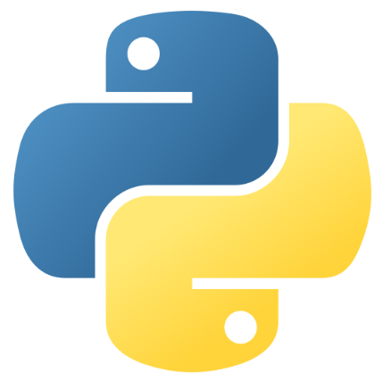
  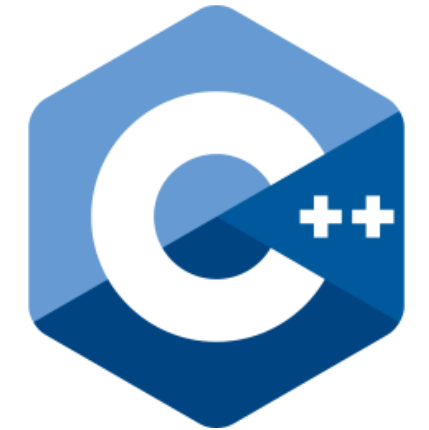
  
  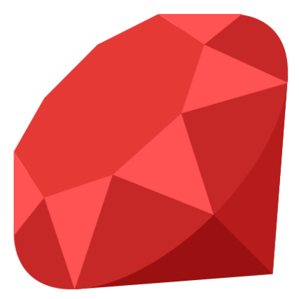
  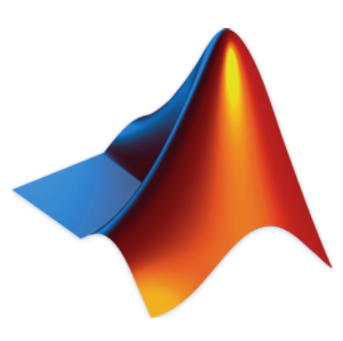
  

  
  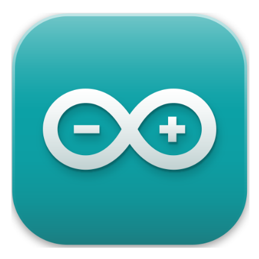
  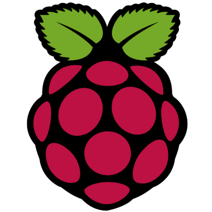
  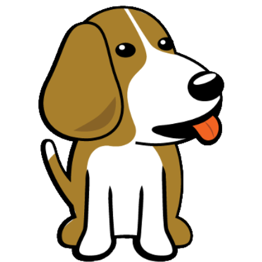
  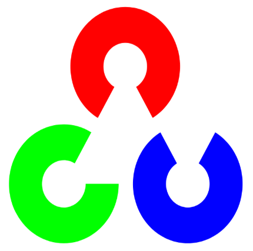
  
  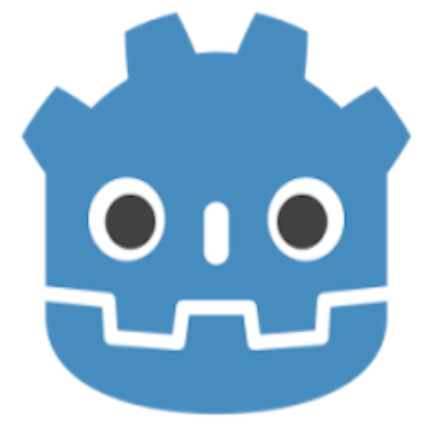

  
  
  
  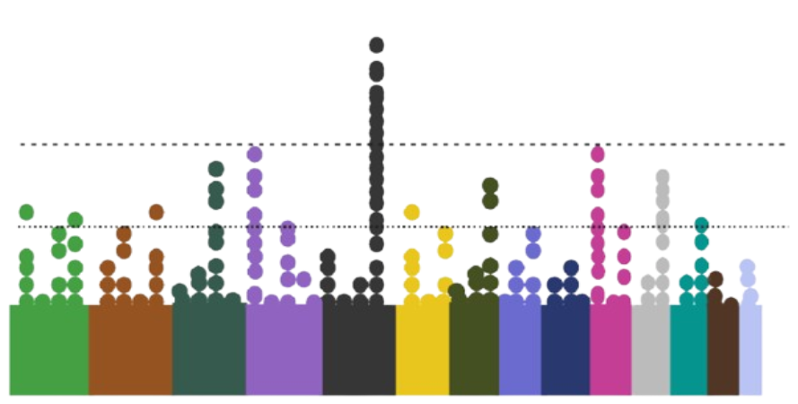

  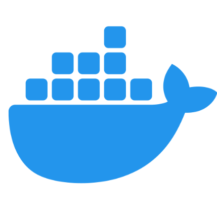
  
  
  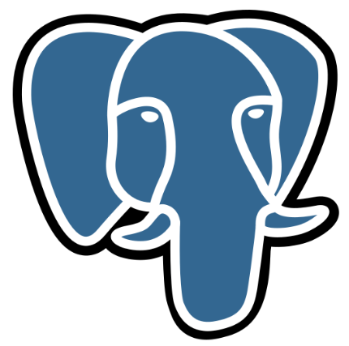
  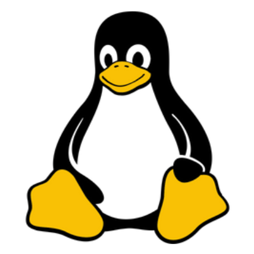
  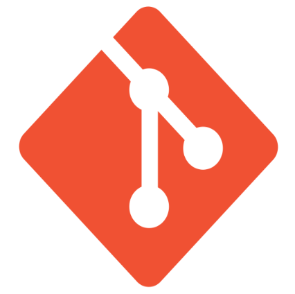

